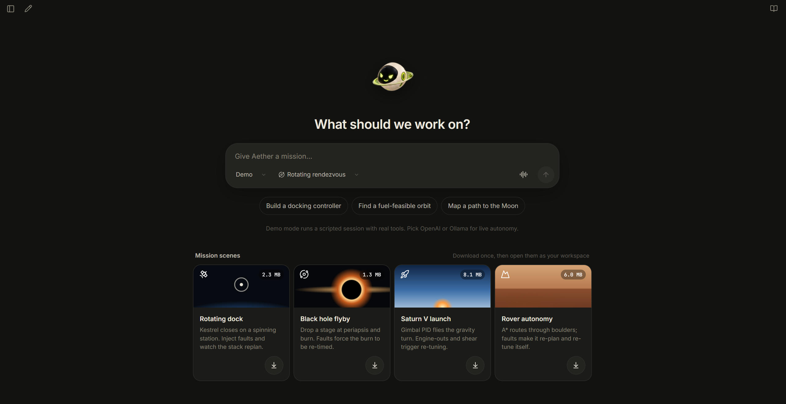
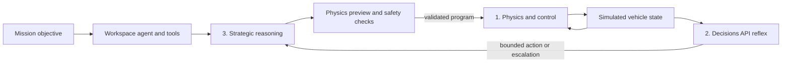

# Aether - Autonomous Intelligence for Space Exploration

**Can AI help guide humanity in space?**

[Try Aether live](https://agent.vedantpandya.com/aether/) | [How the autonomy stack works](docs/AUTONOMY.md) | [Credits](CREDITS.md)



Aether is an autonomous AI assistant for space exploration. Give it a goal in natural language and its mission workspace agent can inspect files, search physics references, write and edit code, run bounded Python experiments and tests, and use simulation tools to check its work. Each run has its own mission workspace and a visible tool history.

## How the assistant works

Aether separates decisions by how often they need to happen. The physics controller keeps running while model requests are in flight; the assistant can use tools to investigate and propose a change, but physical constraints decide whether that change is allowed.

| Layer | What it does in code | When it runs |
| --- | --- | --- |
| **1. Physics and control** | Integrates vehicle state and applies force, torque and fuel limits. The rover uses PID steering; docking uses force- and torque-limited PD control. | Every simulation step, without an API call. |
| **2. Reflex decisions** | Sends a bounded choice and escalation question to the **Decisions API**. Local guards check the current state and can veto the response. | On faults and telemetry checkpoints, outside the physics loop. |
| **3. Strategic reasoning** | Uses a reasoning model with tools to inspect state, search physics knowledge, preview candidate manoeuvres and select a plan. | For harder problems and escalations, such as a damaged engine or blocked approach. |



The workspace harness lives in [`backend/harness`](backend/harness/); the stateful docking plant, reflex policy and strategic planner live in [`backend/physics_models/docking_plant.py`](backend/physics_models/docking_plant.py) and [`backend/autonomy`](backend/autonomy/). Physics references come from [`knowledge/topics.json`](knowledge/topics.json). The assistant runs in a dedicated mission workspace with bounded tools, rather than unrestricted access to the application repository.

The Mars rover scene demonstrates the same control hierarchy with **local rules and A* rollouts**. The server connects Decisions API and model-backed strategic planning to its docking runtime and workspace agent. See [the autonomy guide](docs/AUTONOMY.md) for the implementation and limits.

Space is getting busier. Companies such as [SpaceX](https://www.spacex.com/launches/) are launching rockets and building satellite networks at a remarkable scale. As missions travel farther from Earth, communication delays and unexpected conditions make it harder to guide every move from the ground. AI could help future explorers handle more of those decisions themselves.

Aether explores what it would take for an AI system to help a spacecraft or rover make decisions for itself. It is a space exploration simulator for curious explorers, students and anyone who wants to see autonomous systems working through a physical problem. Describe a mission, inspect the agent's work, or step into an interactive 3D scene and change the conditions yourself.

Built at the [DevDay Exchange Community Hackathon](https://luma.com/dde-ldn-hack) in London on Sunday 1 November 2026.

## Try it

Open **[agent.vedantpandya.com/aether/](https://agent.vedantpandya.com/aether/)**. No installation is needed for the public demo.

1. Find **Rover autonomy** under Mission scenes and download it.
2. Open the scene. The rover plans a route across the terrain and begins driving.
3. Under **Inject a fault**, select **Unmapped boulder**.
4. Watch the control feed: the route is blocked, alternative plans are evaluated, and the rover adopts a new route if one passes the checks.
5. Follow the rover to its waypoint. The feed reports **Goal reached** when it arrives.

In a recorded run, the rover evaluated 12 options, rejected two, adopted a detour and reached the waypoint. The displayed route, state and outcomes come from the running simulation. You can also try a wheel fault, soft sand or a dust storm.

The rover runs its control, reflex rules and route rollouts locally in the browser. The server's model-backed autonomy stack is described below. Simulations are educational approximations, not software for operating real vehicles.

## Demo video

The demo video is being prepared as `demo-video.mp4` in the repository root. The video shows the rover journey and the three-layer architecture in under 90 seconds.

## What Aether does

- **Autonomous mission workspace:** an agent can inspect and search mission files, write and edit code, run bounded Python experiments and tests, consult the physics library and save results in a dedicated workspace.
- **Interactive scenes:** guide a Mars rover, launch a Saturn V model, approach a rotating station or explore a black-hole flyby. Scenes have live controls and faults; each states its model limits in the interface.
- **Physics-based mission planning:** calculate reference trajectories and fuel budgets for orbital transfers, lunar-distance missions, launches, docking, ball throws and idealised interplanetary transfers.
- **Physics library:** search a knowledge graph of more than 120 topics, with equations, assumptions, references and implementation status.
- **Voice:** talk to Aether through the GPT-Live voice interface. The current voice conversation does not operate mission tools.

For example, the lunar model reaches lunar distance rather than calculating a Moon interception, and the black-hole scene uses a Newtonian approximation with artistic lensing. Interplanetary transfers use idealised circular, coplanar orbits. These boundaries matter when interpreting the results.

## Autonomy in action

A recorded live docking run recovered from a 50% thrust loss; see [the verification record](docs/autonomy/VERIFICATION.md). The other server reference missions are not yet connected to that flight supervisor.

## How Codex helped

Codex helped throughout the hackathon. We used it across parallel work on research, the frontend, backend, 3D scenes and testing.

One concrete example was building the custom 3D models for the **rotating docking scene and deep-space flyby**. Codex helped create the station, spacecraft and carrier geometry and get the models into the Three.js scenes. The resulting files are in [the docking assets](public/assets-3d/docking/) and [flyby assets](public/assets-3d/flyby/). GPT-6 Astra helped generate custom 3D models; GPT Image was used for Aether's avatar and expression sprites.

Codex also helped implement the physics checks and tests, including a test that rejects an AI recommendation to continue when there is insufficient fuel. See [the Codex contribution notes](docs/CODEX.md) and [asset credits](CREDITS.md).

## Run locally

### Docker

Install Docker Desktop or Docker Engine with Compose. From the repository directory:

```sh
cp .env.example .env
docker compose up --build
```

On Windows PowerShell, use `Copy-Item .env.example .env` for the first command. Open **http://localhost:8016**. The container serves the frontend and Python API together; mission workspace data persists in a Docker volume. Stop it with `docker compose down`.

### Without Docker

Use Node.js 24 and Python 3.13:

```sh
npm ci
python -m venv .venv
```

Activate the virtual environment (`.venv\Scripts\Activate.ps1` in PowerShell or `source .venv/bin/activate` on macOS/Linux), then run:

```sh
python -m pip install -r requirements.txt
cp .env.example .env
npm run build
python -m uvicorn backend.main:app --host 127.0.0.1 --port 8000
```

In PowerShell, replace `cp .env.example .env` with `Copy-Item .env.example .env`. Open **http://127.0.0.1:8000**. For frontend development, run `npm run dev` in another terminal while the backend is running.

### Models and secrets

The example configuration starts in **demo mode**, which uses explicitly labelled local policies. To use OpenAI, put your key in the ignored `.env` file, set `AGENT_PROVIDER=openai`, and restart the backend. `OPENAI_MODEL` chooses the reasoning model. Voice has its own OpenAI settings and also needs the server-side key. Never put keys in frontend variables or commits.

Ollama and a locally installed tool-capable model, such as Qwen3, are optional. Model availability, quota and hardware requirements depend on your setup. See [.env.example](.env.example), [the autonomy guide](docs/AUTONOMY.md), [voice setup](docs/VOICE_MODE.md) and [the deployment guide](DEPLOY_LIGHTSAIL.md).

### Tests

```sh
python -m pytest -q
npm run build
```

The tests cover physics, control authority, fault recovery, API contracts, the workspace harness and voice. The rover scene is an educational in-browser model; the server tests do not establish real-world vehicle performance. See [physics verification](docs/physics/VALIDATION.md) for analytic checks and their limits.

## Team

- **Team member:** Vedant Pandya
- **Team contact email:** _Add a public contact email before submission._


## What we built today and credits

The hackathon implementation includes the React/Vite interface, Python backend, agent workspace and tools, physics models, knowledge graph, autonomy supervisor, interactive scenes, voice integration, tests and deployment configuration. The original idea and vision existed before the event; the core application was built during the hackathon.

We used existing open-source libraries and APIs, a NASA Blue Marble Earth texture, and user-supplied rover, terrain and launch assets. The rover, Mars texture and Saturn V parts match files in [NASA's 3D Resources repository](https://github.com/nasa/NASA-3D-Resources). Custom spacecraft and station models were created with Codex and GPT-6 Astra; the avatar and expression sprites were generated with GPT Image. See [CREDITS.md](CREDITS.md) for provenance, NASA usage guidance and library credits.

## Build rules

- **Teams:** work solo or in a team of up to four; find teammates on arrival.
- **Build:** create the core project during the hackathon. Existing ideas, libraries, APIs, templates and boilerplate are allowed; previously completed projects are not.
- **Codex:** use it in the build and explain how it helped.
- **Credit:** identify existing code and assets, and show what was made today.

## The day

All times are London local time on Sunday 1 November 2026.

| Time | What happens |
| --- | --- |
| 09:00 | Check-in, coffee and team finding |
| 10:00 | Opening brief, rules and submission walkthrough |
| 11:00-13:00 | Build |
| 13:00-13:30 | Lunch |
| 13:30-17:00 | Build, test and submit |
| **17:00** | **Submissions close**; dinner and first-round judging |
| 18:00-19:00 | Final demos and judging |
| 19:00-19:30 | Awards, photos and close |

## Submit your project

**One submission per team, by 17:00.** Use the submission route shared at the opening brief. Upload early and check your entry went through.

- [x] **Project name and description:** Aether; audience, problem and product are described above.
- [ ] **Team details:** Vedant Pandya; add a public contact email before submitting.
- [ ] **Public GitHub repository:** make this repository public and verify its README, setup and asset credits.
- [ ] **Demo video, maximum 90 seconds:** add `demo-video.mp4` and verify the link opens without a permission request.
- [x] **Use of Codex:** the 3D docking and flyby models are a concrete example above.
- [x] **App link:** [open the live app](https://agent.vedantpandya.com/aether/); the rover instructions are above.

Check all submitted links without signing in. Keep API keys and personal data out of the repository and demo.

## What judges score

| Criterion | What judges look for |
| --- | --- |
| **Idea + usefulness** | A problem worth solving and a compelling, original approach. |
| **Use of Codex** | Meaningful use of Codex, explained with a concrete example. |
| **Execution** | A working product with a complete core user journey. |
| **Demo + clarity** | Show what it does and make the value clear. |

Each criterion is scored from 1 to 5 with equal weight, for a total of 20 points. Six teams reach the final.
