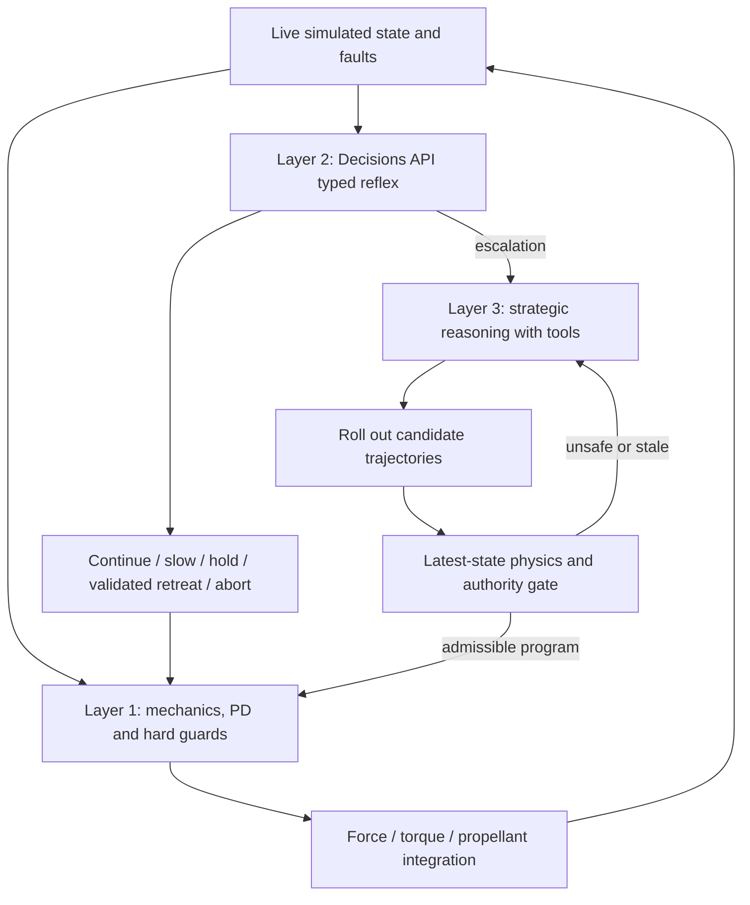

# Aether's three-layer autonomy stack

The runtime separates mechanics, reflex classification and strategic planning. A model never directly sets spacecraft position, velocity, fuel or hardware authority.



## Layer 1: mechanics and control

`backend/physics_models/docking_plant.py` is the shared stateful plant used by both the ordinary physics simulator and the runtime supervisor. It integrates planar CW orbital relative motion, force-limited translational PD with feed-forward, torque-limited attitude tracking, and shared RCS propellant consumption. Default maximum integration step: 0.05 s. This is a PD controller; an integral term is not currently needed in the ideal reference model.

The simulated truth state includes position, velocity, attitude, angular rate, propellant, station phase, actuator degradation and control program. It is not a noisy sensor/EKF implementation. Forces, mass flow and torque actually advance that state. Faults and program changes do not reset position or velocity.

Local guards respond without an API call. A changed engine/obstacle triggers a holding pattern while classification is pending. A reserve or exclusion-boundary violation aborts the mission. The controller cannot burn the protected propellant reserve; an external leak can still remove it. Fuel leaks currently remove co-moving propellant without net recoil; constant scalar inertia remains an explicit approximation.

A hold is an actively controlled moving stand-off reference, not a paused universe. Gravity, station motion, attitude and propellant consumption continue while remote reasoning is pending. This is a best-effort educational simulator, not a hard realtime flight computer.

## Layer 2: Decisions API reflexes

`backend/autonomy/reflex.py` sends a compact physical snapshot and mission context to `POST /v1/decisions` using `gpt-6-luna`. One request batches an action choice and a strategic-escalation predicate. Choices are bounded: `continue`, `slow_down`, `hold`, `retreat`, `replan`, `abort`.

Calls occur on faults and at periodic telemetry checkpoints (default 15 simulated seconds), not at every physics tick. The HTTP connection is reused. Default response deadline is 5 seconds of wall time. Timeout, refusal, malformed or low-confidence output yields an explicitly labelled local fallback. It holds when evidence is missing or a fault is unresolved. If an unchanged approach already has an admissible capture forecast and no unresolved fault, classification uncertainty keeps that verified controller program running; it does not repeatedly restart a safe flight. The confidence threshold is an engineering policy, not a calibrated safety probability.

Every decision is checked against the **current** state. Responses from old hardware/control revisions are discarded. Deterministic fuel/geometry guards veto unsafe model choices. A retreat or slower approach must pass a numerical preview before it is applied. Unresolved physical faults require escalation even if the model's escalation predicate is wrong.

Live engine-fault flight on 1 November 2026: all 17 reflex results came from Decisions API. Observed latencies were 230-1178 ms (median 420.77 ms), including transport overhead. A separate cold smoke call took about 3.0 s. These are observations, not latency guarantees; inference remains outside the mechanics loop.

Official contract: [Decisions guide](https://developers.openai.com/api/docs/guides/decisions).

## Layer 3: strategic reasoning

`backend/autonomy/strategy.py` uses the configured Responses model, or an optional Ollama tool model. Its controller-planning tools inspect current state, retrieve physics knowledge, preview a control program and select a previously previewed candidate. It can propose a slower approach, an angular detour, holding, retreat or abort. It cannot replenish fuel, increase engine capability or relax capture tolerances.

Four initial candidate programs are screened locally and supplied to the model with their evidence and selection IDs. It can choose one immediately or use tools to investigate further. This reduced the tested recovery to one strategic model call. Candidate rollouts use the real remaining propellant, degraded engine/torque authority, obstacle geometry and mission time limit. Before applying a selected proposal, the supervisor independently checks the current revision and rolls it out again from the **latest** state. State, velocity and fuel remain continuous across an applied program change.

The strategic loop allows at most six model turns and checks a 20,000-token soft budget between continued turns; a session allows at most three strategic requests by default. It has a 45 s wall deadline. Nominal flights do not call it. A failed strategic request leaves the local holding controller in charge.

The longer general mission-reasoning layer reuses the existing workspace harness through `/api/autonomy/strategic-runs`. That agent can read/grep/edit mission files, run numerical code/tests, retrieve physics and calculate all supported reference missions. Its new `assess_swingby` tool computes a local hyperbolic encounter's turning angle and heliocentric energy change.

The live 50% thrust-loss example recovered and docked at t=241.85 simulated seconds with one strategic request and one model call. Position and fuel discontinuities across the applied program change were both zero. An earlier standalone tool smoke check took 13.5 s over three calls; candidate shortlisting now avoids redundant calls. See [recorded verification](autonomy/VERIFICATION.md).

Official contract: [Responses function calling](https://developers.openai.com/api/docs/guides/function-calling).

## Swingby boundary

`POST /api/autonomy/swingby` accepts an incoming hyperbolic excess velocity, planet velocity, planet, periapsis altitude and turning direction. It computes the hyperbola turn, conserved planet-frame speed, periapsis speed, heliocentric velocity and energy change, and a conservative altitude screen.

It does **not** solve a calendar-date encounter, B-plane targeting, incoming/outgoing Lambert legs, atmospheric heating or a complete gravity-assist route. It always returns `encounter_targeting_verified=false` and `eligible_for_execution=false`. The reasoning agent can evaluate the physics of a proposed encounter; it cannot claim a favorable energy gain proves a reachable, executable itinerary.

## Run the complete examples

No server or frontend is needed for these scripts:

```sh
# Explicit offline stack: real plant, faults, previews and actions; no LLM calls.
python scripts/run_autonomy.py --scenario engine-fault
python scripts/run_autonomy.py --scenario obstacle
python scripts/run_autonomy.py --scenario fuel-leak

# Live OpenAI stack; reads the ignored server .env.
python scripts/run_autonomy.py --mode openai --scenario engine-fault --factor 5

# Small live integration check rather than a full flight.
python scripts/smoke_autonomy_live.py --strategy
```

The engine-fault example loses 50% of translation thrust at t=25 s. The obstacle example blocks the nominal approach and validates an angular detour. The severe leak example aborts to protect the reserve; it does not pretend every mission can be recovered.

Default app configuration remains whatever `.env` declares. Passing `mode=openai` explicitly enables live models for a session without changing that file. In `demo` mode both model layers are labelled deterministic replacements. Ollama can provide strategic reasoning; when no OpenAI key is available its reflex layer is explicitly local.

## Workspace agent integration

The workspace harness exposes `run_autonomous_mission(config_path, scenario)`. Scenarios are `nominal`, `thrust_loss`, `obstacle` and `fuel_leak`; runtime missions must currently be docking. The harness reasoning instructions select this tool for autonomous flight/recovery tasks, while `simulate_mission` continues to calculate reference trajectories for the other mission types.

The tool uses the run's provider, executes the real runtime, and populates the existing harness simulation viewer with the actual trajectory. Its `autonomy_started` event includes the session ID and state/SSE URLs for a live layer panel. It writes `artifacts/autonomy-summary.json`, `artifacts/trajectory.json` and `artifacts/plan.json` into the dedicated mission workspace. Exported trajectories are thinned to the workspace file quota while preserving the final sample; the runtime endpoint retains the full trajectory.

Cancelling the parent run stops its flight and pending requests. Each runtime layer reports its own request/usage counters; these child-model tokens are separate from the general harness agent's reasoning-token counter. `demo` is an explicit deterministic replacement for the two model policies, not a claimed OpenAI run.

## Frontend/API handoff

- `GET /api/autonomy/capabilities`: supported layers and scope.
- `GET /api/autonomy/examples`: four complete request presets.
- `POST /api/autonomy/sessions`: start a runtime flight.
- `GET /api/autonomy/sessions/{id}?after=<event-id>`: current physical state, layer counters and new events.
- `GET /api/autonomy/sessions/{id}/events`: SSE event stream; each event has `id`, `layer`, `type`, simulated `t`, wall `at`, and `data`.
- `POST /api/autonomy/sessions/{id}/inject`: queue a validated fault on an active session.
- `POST /api/autonomy/sessions/{id}/stop`: cancel the session and its pending requests.
- `GET /api/autonomy/sessions/{id}/simulation`: full computed trajectory, including failed/aborted attempts.
- `POST /api/autonomy/strategic-runs`: create a workspace strategic task using the harness RunRequest schema.
- `POST /api/autonomy/swingby`: local hyperbolic flyby assessment.

Example request:

```json
{
  "mode": "demo",
  "paced": false,
  "faults": [{"type": "thrust_loss", "at_s": 25, "value": 0.5}]
}
```

For live mode use `"mode":"openai"`, `"paced":true`. Default replay acceleration is five simulated seconds per wall second. Live requests require pacing so the simulated mission cannot finish before its network responses have had time to return.

Initial request faults are scheduled by `at_s`; `/inject` queues a fault for the next controller tick. Faults: `fuel_leak`, `thrust_loss`, `torque_loss` use a fractional loss; `station_spin_change` uses a new rpm; `obstacle` uses `value` as radius in metres and `position_m` as a local XY point. Spin changes preserve phase continuity. Obstacles are static geometric exclusion regions in the local frame, not propagated debris objects.

Useful event types: `telemetry` (L1), `local_guard` (L1), `reflex_requested` / `reflex_decision` / `reflex_discarded` (L2), `strategic_requested` / `strategic_preview` / `strategic_model` (L3), `program_applied` / `proposal_vetoed` (L1), `fault`, and `status`.

Runtime closed-loop coupling currently supports **docking**. All six reference physics models remain available to the strategic workspace agent. Runtime sessions are process-local; JSON event/state/trajectory logs persist under ignored `.aether/autonomy/<id>`. Server restarts do not silently resume a flight.

Run `python -m pytest -q` for analytic physics, API, asynchronous handoff, fault-recovery and authority tests. See [physics API contract](PHYSICS_API.md) and [physics verification snapshot](physics/VALIDATION.md).
